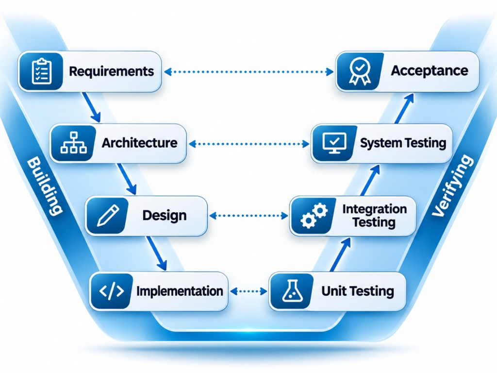

# V-Model AI Product Factory — Starter

## The idea: an AI Product Factory

AI agents can now generate entire applications in minutes. The hard part is no longer *writing* code. It is making sure the result actually works, is complete, and doesn't break as it grows. If you ask a single agent to build a product, it forgets earlier decisions, misses requirements, and breaks things that used to work as the project grows.

The **AI Product Factory** addresses this with the **V-model**, an engineering methodology proven over decades in automotive, aerospace, and medical devices. Every stage of the V has its own specialized AI agent:

- On the **left side**, agents build the product top-down: Requirements → Architecture → Design → Implementation.
- On the **right side**, agents verify it bottom-up: Unit Testing → Integration Testing → System Testing → Acceptance.
- Each verification stage checks the development stage **on the same level of the V**.
- A global **orchestrator** coordinates the agents, routes every problem to the agent responsible for it, involves humans in the decisions that matter, and keeps **traceability** valid at all times. Every requirement can be followed to the architecture, design, code, and tests that realize and verify it, and back again.

Because AI makes tests cheap to write and run, the factory doesn't compromise on testing. It requires 100% unit coverage including branches, integration testing of every interface, end-to-end testing of every scenario including failure and edge cases, and acceptance of every requirement against its criteria. The factory repeats the cycle until everything passes. Ideas go in, and high-quality, correctly working products come out, backed by evidence.

📖 **Read the full concept:** [AI Product Factory: The Case for the V-Model](docs/ai-product-factory.md)



## The agents

There are eight stage agents, one per V-model stage, coordinated by the orchestrator. Each pair works on the same level of the V:

| Level | Left side: building | Agent spec | ↔ | Right side: verifying | Agent spec |
|---|---|---|---|---|---|
| 1 | **Requirements**: actors, use cases, optional user stories, EARS requirements, scenarios | [`requirements-agent.md`](.cursor/agents/requirements-agent.md) | ↔ | **Acceptance**: every requirement's acceptance criteria tested, with a verdict per concept goal and requirement | [`acceptance-agent.md`](.cursor/agents/acceptance-agent.md) |
| 2 | **Architecture**: components, interfaces, technology, toolchain | [`architecture-agent.md`](.cursor/agents/architecture-agent.md) | ↔ | **System Testing**: the complete system end to end, as architected (every component, external interface, and scenario) | [`system-test-agent.md`](.cursor/agents/system-test-agent.md) |
| 3 | **Design**: units, behavior, collaborations, interface realization | [`design-agent.md`](.cursor/agents/design-agent.md) | ↔ | **Integration Testing**: units and components working together as designed | [`integration-test-agent.md`](.cursor/agents/integration-test-agent.md) |
| 4 | **Implementation**: code exactly as designed | [`implementation-agent.md`](.cursor/agents/implementation-agent.md) | ↔ | **Unit Testing**: every code unit against its specification, with 100% line and branch coverage | [`unit-test-agent.md`](.cursor/agents/unit-test-agent.md) |

The **Orchestrator** ([`orchestrator.md`](.cursor/agents/orchestrator.md)) runs as the top-level chat session. It schedules work, in parallel where possible, validates every agent's report against evidence, enforces the eight quality gates, routes defects, analyzes change impact, and asks you for the decisions only a human can make.

Each agent owns specific files and **never edits another agent's files**. Each verifying agent takes its expected results from the specification on its own level of the V, never from the code. The implementation agent can't touch tests, and test agents can't touch code. That separation of duties is what turns "the AI says it works" into evidence.

## Quick start (Cursor)

1. Open this folder in Cursor.
2. Describe your product in [`factory/concept/concept.md`](factory/concept/concept.md), the factory's input. It can be rough: the Requirements Agent will find gaps and ask you about them. Under **Factory options**, choose whether you also want user stories. Use cases are always written.
3. In a chat, run **`/factory`**. The chat session becomes the Orchestrator and hands each stage to its agent.
4. Answer questions when the factory asks them. You approve two gates yourself: the **requirements** (H1) and the final **acceptance** (H2).
5. To change something later, run **`/factory-change <description>`**. The orchestrator works out which artifacts are affected, has the owning agents update them, and re-runs verification.

Check traceability at any time:

```bash
python3 scripts/trace_check.py --gate design      # check everything up to the design stage
python3 scripts/trace_check.py --gate acceptance  # full check; also regenerates factory/trace/matrix.md
python3 scripts/trace_check.py --impact REQ-004   # everything affected by changing REQ-004
```

Gates follow the eight stages: `requirements`, `architecture`, `design`, `implementation`, `unit`, `integration`, `system`, `acceptance`.

## How a run flows

```
Left side, top-down. Each right-side stage specifies its tests as soon as its pair is baselined:

  Requirements ─► [H1] ─► Architecture ─► Design ─► Implementation
       │                       │             │             │
       ▼                       ▼             ▼             ▼
  Acceptance spec      System test spec  Integration   Unit test spec
                                         test spec

Right side, bottom-up, once code exists (each loop: test → route defect → fix → re-test):

  Unit Testing ⟳ ─► Integration Testing ⟳ ─► System Testing ⟳ ─► Acceptance ─► [H2]
```

Details: [`docs/process.md`](docs/process.md).

## Repository layout

```
.cursor/
  agents/          Agent specifications (orchestrator + 8 stage agents) — the agent logic lives here
  commands/        /factory and /factory-change entry points
  rules/           Always-on factory rules for every agent
docs/
  ai-product-factory.md  The concept (extended edition of the original article)
  process.md       Stages, pairs, gates, parallelism, loops, change management
  traceability.md  ID scheme, link syntax, checker rules
  ears.md          EARS syntax for requirement statements (enforced by the checker)
  protocols.md     Work orders, agent reports, defects, change requests
  quality-gates.md Exit criteria for each of the eight stages
templates/         Artifact templates the agents copy from
factory/
  concept/         The factory's input: your product concept
  requirements/  architecture/  design/       Left-side artifacts
  verification/{unit,integration,system}/  acceptance/   Right-side test specs and reports
  state.yaml  log.md  questions.md  defects/  changes/  decisions/  trace/
src/               Product code (Implementation Agent)
tests/             unit/  integration/  system/  acceptance/  (one agent per level)
scripts/           trace_check.py (traceability checker) and its tests
```

## Core principles

1. **Every stage is covered.** No code without design, no design without architecture, no architecture without requirements, and every one of them verified on its own level of the V.
2. **Traceability is always valid.** Every item has an ID and links to its source. The checker enforces this in both directions at every gate.
3. **Tests check the code against the specification**, never against what the code happens to do.
4. **Comprehensive testing is the default.** That means 100% unit line and branch coverage, every interface integrated, every scenario run end to end, and every requirement accepted against its criteria.
5. **Loops instead of a single pass.** The agents test, fix, and test again until the gate passes, within an iteration budget. When the budget runs out, the factory asks a human.
6. **Humans decide what only humans can.** That includes product goals, ambiguities, trade-offs, and final acceptance.

## Specification, component, and baseline checks

You start the factory through the native Cursor commands, agents, and rules. When agents write test cases early, specification checks verify their work. Individual components can also move forward through intermediate checks, but passing one of these checks does not mean the global gate has passed:

```bash
python3 scripts/trace_check.py --gate unit --phase specify --scope ARCH-001
python3 scripts/trace_check.py --gate implementation --scope ARCH-001
python3 scripts/trace_check.py --baseline <commit> --paths factory/design/ARCH-001-example.md --json
python3 scripts/trace_check.py --impact DES-001 --json
```

Global gates use the original execute checks without a scope restriction. At G4, Implementation regression runs the existing automated unit tests. The initial test automation and strict coverage checks follow after G4, and verification that is still pending is recorded explicitly. Aggregate G5 still requires 100% line and branch coverage over all source files. Change impact separates artifacts that may need revision from tests that may need to run again. When a run resumes, the factory compares baseline content with Git separately from checking trace links. Before work starts in parallel, the orchestrator reserves the exact files and ID ranges and saves snapshots of their starting state. Unexpected changes are preserved until they can be reconciled.
