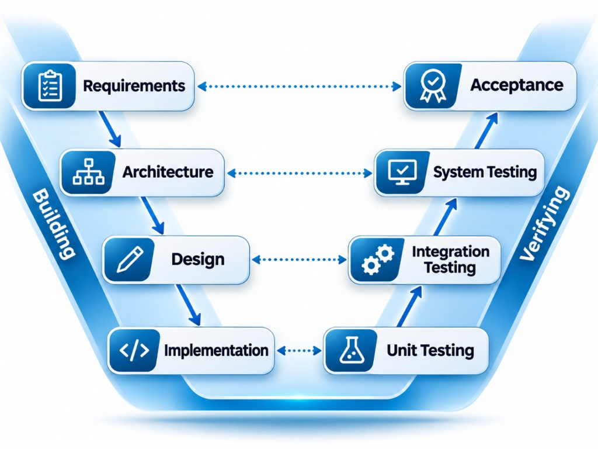

# AI Product Factory: The Case for the V-Model

_How proven engineering principles can help AI turn ideas into finished products_

**Igor Tryndin** · Intelligent Autonomy @ Lucid Motors · Founder, Washboat.Art
Originally published on [LinkedIn](https://www.linkedin.com/in/igorek/), November 18, 2026. This is an extended edition that accompanies the [V-Model AI Product Factory starter](../README.md).

---

## Why the V-model matters

For decades, industries such as automotive, aerospace, and medical devices have relied on an engineering methodology known as the **V-model**. It has been especially valuable in safety-critical applications, where defects can have serious consequences and the quality of the final product must be systematically verified.

The idea behind the V-model is simple: **first define what needs to be built and how it should work, then systematically verify that the result meets those expectations.** It organizes development into two sides:

- **Left side — documenting and building the product:** Requirements → Architecture → Design → Implementation.
- **Right side — verifying and validating the product:** Unit Testing → Integration Testing → System Testing → Acceptance.

The two sides are connected. Each development stage has a corresponding verification activity **on the same level of the V**:

| Level | Building (left) | ↔ | Verifying (right) | The question it answers |
|---|---|---|---|---|
| 1 | **Requirements** | ↔ | **Acceptance** | Did we build the product that was required, and does it meet its acceptance criteria? |
| 2 | **Architecture** | ↔ | **System Testing** | Does the complete, integrated system work as it was structured to? |
| 3 | **Design** | ↔ | **Integration Testing** | Do the units and components work together as designed? |
| 4 | **Implementation** | ↔ | **Unit Testing** | Does every piece of code do exactly what its specification says? |

Whatever gets built can always be checked against what was originally intended, at the level where that intent was written down.

This becomes extremely relevant in the age of AI. We already have AI agents that can generate substantial amounts of code in minutes, build entire applications, and implement complex functionality, and their capabilities are improving rapidly. That raises a very important question: **how do we make sure all this AI-generated software actually works correctly, is complete, and doesn't break as it grows?**

The V-model provides an excellent foundation for answering it.

## Every stage matters

Decades of software engineering have taught us that building a successful product takes much more than writing code. You need clear **requirements** describing what the product is supposed to do. You need an **architecture** defining how the major pieces fit together, and a **design** explaining how those pieces are engineered in detail. Then comes **implementation**, when you actually write the code. And you need systematic, **multi-level testing** to make sure everything works as intended, from individual components up to the complete product.

These aren't formalities invented by large engineering organizations. Missing any of them is a well-known recipe for trouble:

- **Poor requirements** lead to missing or incorrect functionality.
- **Weak architecture** creates systems that are difficult to extend or maintain.
- **Inadequate design** results in inconsistent implementations.
- **Insufficient testing** lets defects linger, and they become more expensive to fix the longer they survive.

Even small projects need these elements, although they can be much simpler and less formal.

What makes the V-model particularly useful is that it brings all these activities together and connects them through **traceability**.

### Traceability, concretely

Traceability means that every element can be followed through the entire development process: from the original idea to the architecture, the design, the implementation, and ultimately to every test that verifies it. It also works in reverse. Every piece of functionality can be traced back to the requirement that explains why it exists, and every test to the architecture or design element it checks.

Picture a single requirement: *"If a session token is older than 30 minutes, then the system shall reject the request."* Traceability lets you follow it to the architecture component that enforces sessions, the design unit that computes token age, the function that implements it, and the tests at every level that prove it works, including the boundary case of a token that is exactly 30 minutes old. Now imagine the limit changes to 15 minutes. Traceability tells you exactly which design units, code, and tests must be updated and re-run. Nothing is missed and nothing is changed unnecessarily.

This is extremely valuable in traditional engineering. It becomes even more important when AI is doing most of the work.

## Turning the V-model into an AI Product Factory

Here is where things get really interesting. Imagine taking this proven engineering methodology and assigning **a specialized AI agent to every stage of the V-model**.

| Stage | Agent | What it does |
|---|---|---|
| Requirements | **Requirements agent** | Turns your product concept into a detailed specification: actors, use cases, and precise, testable requirements |
| Architecture | **Architecture agent** | Works out how the system should be structured: components, interfaces, and technology choices |
| Design | **Design agent** | Works out the details of every component: units, behaviors, data, error handling, and how the units collaborate |
| Implementation | **Implementation agent** | Generates the actual software code, exactly as designed |
| Unit Testing | **Unit testing agent** | Verifies every piece of code in isolation against its specification |
| Integration Testing | **Integration testing agent** | Verifies that units and components fit together as designed |
| System Testing | **System testing agent** | Verifies the complete system end to end, as architected |
| Acceptance | **Acceptance agent** | Verifies that every requirement is met and the product is implemented as intended |

Overseeing all of this is a global AI **orchestrator**. It coordinates the agents, manages their interactions, decides what can happen in parallel, routes every discovered problem to the agent responsible for it, and ensures that everything stays consistent. Most importantly, the system maintains **complete, continuously valid traceability** across requirements, architecture, design, implementation, and every level of testing. Nothing gets lost between stages. When something changes, the affected parts are identified, updated, and verified again.

This doesn't have to be a rigid, sequential process. The agents can work in parallel, exchange information, and iterate as needed. Each verifying agent can start writing its tests as soon as its paired stage on the left is complete, long before any code exists: the acceptance agent right after the requirements, the system testing agent right after the architecture, and so on. What matters is that every stage is properly covered and the entire system remains consistent.

This coordinated ensemble of AI agents is what I call the **AI Product Factory**.

### Why separate agents, and not one very capable one?

Splitting the work is not just about parallelism. It creates **independence**. The agent that writes the code is not the agent that decides whether the code is correct. Each verifying agent takes its expected results from the specification on its own level of the V, never from the code it is checking. The acceptance agent sees only the requirements, and it doesn't care how the product was built. The implementation agent is not allowed to touch the tests. When a test fails, the orchestrator decides whether the code, the test, or the specification is wrong, and sends the problem to the agent that owns it.

That separation of duties is what turns "the AI says it works" into evidence.

## Comprehensive testing becomes practical

Here is another important part of the idea. In traditional software development, comprehensive testing has always been expensive. Writing tests takes time, maintaining them takes effort, and teams constantly balance testing against the pressure to deliver new features. As a result, coverage is often incomplete, and some problems aren't discovered until much later.

AI fundamentally changes that equation. If an AI agent can generate and execute tests almost as easily as it generates code, why should we keep accepting the same compromises?

- **Why not simply require 100% unit test coverage**, including branch coverage, negative tests, boundary conditions, and error handling?
- **Why not require comprehensive integration testing** to verify that all components fit together properly?
- **Why not test every feature and every defined end-to-end user scenario**, including failure conditions, unusual situations, and rare edge cases?

The AI factory can generate these tests, execute them, analyze failures, fix problems, and loop through this cycle until all tests pass. As requirements or implementations change, the corresponding tests are updated automatically. Testing becomes a continuous activity rather than something squeezed in at the end of development.

Of course, 100% code coverage doesn't automatically mean the software is bug-free. Tests are only as good as the scenarios and expected behaviors they check. Crucially, **tests must verify the implementation against the original requirements, not just against the assumptions made by the AI agents that generated the code.** Combining extensive testing with well-defined requirements, consistent design, and continuous traceability gives us a much stronger foundation for quality than asking AI to write code and checking whether it appears to work.

Finally, the **Acceptance** stage brings everything back to where we started: the original requirements, on the same level of the V. The AI factory verifies that every requirement has been addressed, that the product is **implemented as intended**, and that it meets its defined acceptance criteria. The result is not just working software, but a product backed by evidence of what was required, how it was built, and how it was tested.

## Solving the biggest problems of AI-generated software

If you've used AI to build software, you've probably seen both sides of the experience. It's amazing how quickly AI can turn an idea into something that actually works. But as the project grows, problems begin to appear. AI may forget earlier decisions, introduce inconsistencies, miss some requirements, or break existing functionality while implementing something new. **You spend a surprising amount of time going back and forth, fixing issues that shouldn't have happened in the first place.**

These problems don't necessarily disappear just because AI models get better at coding. As AI agents take on larger and more complex projects, the need to manage the entire development process systematically becomes even more important.

**The V-model-based AI Product Factory addresses these problems by moving from isolated AI coding tasks to a complete, coordinated engineering process.**

| Typical problem with AI-generated software | How the factory counters it |
|---|---|
| Forgets earlier decisions | Requirements, architecture, design, and decisions are written down and baselined; every agent works from them, not from memory |
| Introduces inconsistencies | Each stage is checked against the one above it, and traceability is verified continuously |
| Misses requirements | Every requirement must be traced to the architecture, design, code, and tests, and receive an acceptance verdict |
| Breaks existing functionality | Change impact is computed from the trace graph, and every level of tests runs as regression |
| "Works on my prompt" | Independent verifying agents, with expected results taken from specifications rather than from the code |

Instead of relying on one agent to somehow remember everything and do everything correctly, we distribute responsibilities across specialized agents, give them a proven structure to work within, and continuously check their outputs against the specifications. Architecture and design are explicitly maintained, tests continuously verify the results, and traceability keeps requirements and implementation aligned throughout development.

Will this consume more AI tokens and computing resources than simply asking an agent to generate code? Absolutely. But that isn't necessarily a problem. If spending more tokens on architecture, design, testing, and verification produces a significantly better product with fewer defects and less rework, it is money well spent.

None of this guarantees perfection. If the original idea is poorly defined, even a perfectly executed process can produce the wrong product. That's why the factory must also identify ambiguities, ask questions when necessary, and involve humans in important decisions. But it gives us a systematic way to prevent many of the problems that make AI-driven development unpredictable today.

## From an idea to a finished product

Now imagine the experience from the perspective of someone who has a product idea but doesn't necessarily know how to write software.

1. **You describe what you want to build** and work with AI to refine the concept until the goals are sufficiently clear.
2. **You hand the concept to the factory.** The agents take over: defining the requirements, creating the architecture, designing the solution, implementing it, and systematically testing everything.
3. **You confirm the requirements.** The factory shows you what it understood, in plain language (who uses the product, what they can do, what happens when things go wrong), and asks about anything ambiguous.
4. **The factory iterates.** It finds inconsistencies, corrects defects, and keeps going until all tests pass and the product satisfies its acceptance criteria.
5. **You accept the product**, backed by an acceptance report showing, requirement by requirement, the evidence that it works.

You stay involved where your judgment is needed, especially for product goals, important decisions, and final acceptance. But you no longer have to personally manage every detail of the engineering process.

Software is the obvious starting point, because AI can directly generate, execute, and test code. But there's no reason the same concept couldn't eventually extend to digital hardware, physical products, and other areas where AI can automate design, engineering, and testing, even if some stages require real-world manufacturing and validation.

And that's the bigger idea behind the **AI Product Factory**.

Today, we mostly think about AI as a tool that helps us write code faster. But what if we stop thinking in terms of code generation and start thinking in terms of complete product development? What if an idea can enter a coordinated system of AI agents and emerge as a fully implemented, comprehensively tested, high-quality product?

The interesting part is that we don't need to invent an entirely new engineering methodology to make this happen. We can take the V-model, a framework proven over decades of engineering practice, and combine it with the rapidly growing capabilities of autonomous AI agents.

**The result could be a new way of building products: faster, more systematic, and accessible to far more people.**

**A factory where ideas go in, and high-quality, correctly working products come out.**

---

_Want to try it? The [V-Model AI Product Factory starter](../README.md) implements this concept: eight stage agents plus an orchestrator, with continuously checked traceability._
