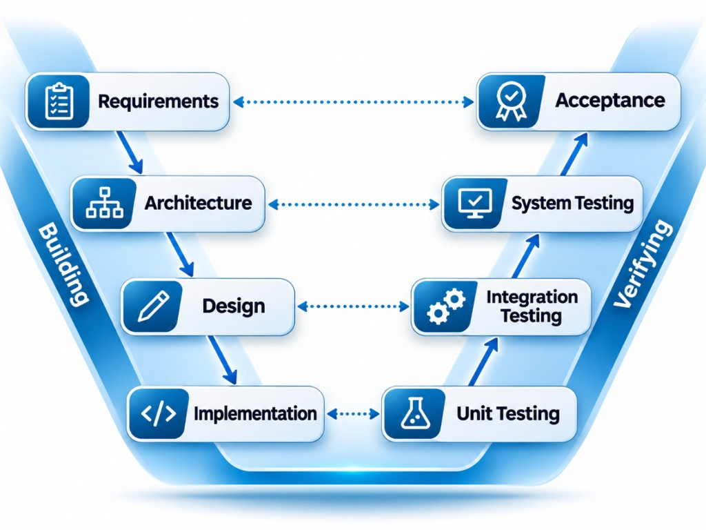

# Factory Process

This document describes how the factory runs end to end. Agent-specific logic lives in `.cursor/agents/`. Message formats are in [`protocols.md`](protocols.md), exit criteria in [`quality-gates.md`](quality-gates.md), and ID and link rules in [`traceability.md`](traceability.md).



## 1. The eight stages and their pairs

The factory has exactly the eight V-model stages: four on the left side (building) and four on the right side (verifying). Each development stage is paired with the verification activity on the same level of the V:

| Level | Left side: building | Agent | Produces | ↔ | Right side: verifying | Agent | Verifies against |
|---|---|---|---|---|---|---|---|
| 1 | **Requirements** | Requirements Agent | Actors, use cases `UC`, optional user stories `US`, requirements `REQ` (EARS), scenarios `SCN` | ↔ | **Acceptance** | Acceptance Agent | Every `REQ` and its acceptance criteria (`AT` cases), plus a verdict per concept goal and requirement |
| 2 | **Architecture** | Architecture Agent | Components `ARCH`, interfaces `IF`, external actors and systems `EXT`, decisions, toolchain | ↔ | **System Testing** | System Test Agent | The complete integrated system, as architected, end to end: every component, every external interface, every scenario flow (`ST` cases) |
| 3 | **Design** | Design Agent | Design units `DES`: signatures, behavior, collaborations, realization of interfaces | ↔ | **Integration Testing** | Integration Test Agent | Units and components working together as designed: every internal interface and unit collaboration (`IT` cases) |
| 4 | **Implementation** | Implementation Agent | Code in `src/` tagged `@implements DES-###` | ↔ | **Unit Testing** | Unit Test Agent | Every implemented code unit against its unit specification (`UT` cases), with 100% line and branch coverage |

The **concept** (`factory/concept/concept.md`) is not a stage. It is the factory's *input*: the human's refined product idea, whose goals are numbered `CON-###` so that requirements and the final acceptance verdicts can be traced back to it.

Each pair is a **contract**. A right-side agent writes its test specification from its left-side counterpart **as soon as that counterpart is baselined**, before any code exists. This is the horizontal link of the V-model, and it keeps the tests independent of the code. (Unit tests verify implemented units, but their expected results come from the unit specifications in the design, so they too can be written as soon as the design is baselined.)

## 2. Stage lifecycle

Each stage in `factory/state.yaml` moves through these states:

```
not_started → in_progress → in_review → baselined
                   ▲             │            │
                   └── rework ◄──┘            │ (upstream change / defect)
                                              ▼
                                         invalidated → in_progress …
```

- **in_progress**: the owning agent is working on the stage.
- **in_review**: the agent says it is done. The orchestrator runs the gate checks and a *consumer review*: the agents that depend on the artifact review it. These are the next agent down the left side, plus the paired verifying agent on the right side (for example, the Architecture Agent reviews the requirements for feasibility, and the Acceptance Agent reviews them for testability).
- **baselined**: the gate passed. The orchestrator records the baseline (git commit `factory: baseline <stage> vN`) and dependent work may begin.
- **invalidated**: an upstream change or a specification defect affects this stage. Only the affected items are reworked (see section 6).

## 3. Flow and parallelism

```
H1 = human approval of the requirements baseline (mandatory)
H2 = human acceptance sign-off (mandatory)

Left side, top-down (each right-side specification starts as soon as its pair is baselined):

  Requirements ─► [H1] ─┬─► Architecture ─┬─► Design (per component) ─┬─► Implementation (per component)
                        │                 │                           │
                        └─► AT spec       └─► ST spec                 ├─► IT spec
                                                                      └─► UT spec (per component)

Right side, bottom-up execution once code exists:

  Unit Testing ⟳ fix ─► Integration Testing ⟳ fix ─► System Testing ⟳ fix ─► Acceptance ─► [H2]
```

Rules for running work in parallel:

1. A work order may start once **every artifact it reads is baselined**.
2. Work orders that write to **different owned paths** may run at the same time, for example Design for `ARCH-001` and Design for `ARCH-002`, or Implementation and the unit test specification for the same component.
3. Two agents never write to the same path at the same time. The ownership map makes this automatic.
4. Execution order on the right side is bottom-up: there is no point running system tests on a build with failing unit tests. The *specifications* for all four levels are written early and in parallel. Each time a level runs, all lower levels are re-run as regression.

### Incremental delivery

Large products should be built in **increments** (vertical slices), each one a full trip down and up the V. Use cases make natural slice boundaries: one increment can deliver a set of complete use cases, including their extensions. Requirements carry a `Priority` (`must`/`should`/`could`). The orchestrator may baseline the `must` set first and run the V for it, then add the next slice through change control. Traceability and regression testing keep earlier slices intact.

## 4. Gates

One gate per stage:

| Gate | Stage | Who decides | What is checked |
|---|---|---|---|
| G1 | Requirements | Orchestrator, then **human (H1)** | Checklist, `trace_check --gate requirements` (includes the concept goals having `CON` IDs), no blocking `Q-###` |
| G2 | Architecture | Orchestrator (human optional, recommended for major tech choices) | Checklist, `--gate architecture`, toolchain recorded |
| G3 | Design | Orchestrator | Checklist, `--gate design` |
| G4 | Implementation | Orchestrator | Builds, lints cleanly, `--gate implementation` |
| G5 | Unit Testing | Orchestrator | All UT pass, 100% line and branch coverage, `--gate unit` |
| G6 | Integration Testing | Orchestrator | All IT pass, unit regression green, `--gate integration` |
| G7 | System Testing | Orchestrator | All ST pass, lower levels green, `--gate system` |
| G8 | Acceptance | Acceptance Agent, then **human (H2)** | All AT pass, every `CON` and `REQ` accepted with evidence, `--gate acceptance` |

A gate never passes on an agent's word alone. The orchestrator re-runs the mechanical checks itself.

## 5. Verification loops and defect routing

When a test fails, the agent that owns the test writes a **defect report** (`templates/defect.md`) and classifies the defect:

| Classification | Meaning | Routed to |
|---|---|---|
| `code` | The implementation doesn't match the design, architecture, or requirements | Implementation Agent |
| `test` | The test itself is wrong (bad setup, or an oracle that misreads the specification) | The agent that owns the test. It must cite the specification clause it misread |
| `design` | The design is incomplete or contradicts the architecture or requirements | Design Agent, then anything downstream re-runs |
| `architecture` | A component, interface, or allocation is wrong | Architecture Agent, then anything downstream re-runs |
| `requirement` | The requirement is ambiguous, contradictory, or untestable | Requirements Agent, plus a **human question** if behavior a user could observe would change |
| `environment` | Toolchain, flaky infrastructure, or test harness | Owner of the toolchain (Architecture) or of the harness (the test agent) |

The loop for each defect is: route it, fix it, re-run the failing test, then re-run that whole level and all levels below it.

**Anti-gaming rules.** A defect may not be "fixed" by:
- weakening, skipping, or deleting a test without a `test` classification that cites the specification;
- special-casing the test input in production code;
- excluding code from coverage without a recorded decision (`DEC-###`) that the orchestrator accepts.

## 6. Change management and impact analysis

Changes come from a human (`/factory-change`), from a defect classified as `requirement`, `architecture`, or `design`, or from a finding during review.

1. The orchestrator writes `factory/changes/CR-###.md` (`templates/change-request.md`).
2. **Impact analysis.** It identifies the directly changed IDs, then walks the trace graph *downstream* (`python3 scripts/trace_check.py --impact REQ-004`) to collect every dependent item: ARCH, IF, DES, code files, and test cases at all four verification levels.
3. It marks the affected stages `invalidated` in `state.yaml` and lists the affected IDs.
4. It issues work orders **top-down**, limited to the affected IDs: Requirements, then Architecture, then Design, then Implementation. The paired test specifications are updated in parallel as each counterpart is re-baselined.
5. It re-runs verification bottom-up for the affected items (unit, integration, system), with full regression at each level.
6. Acceptance re-runs the affected acceptance tests and re-evaluates the affected `CON` and `REQ` verdicts. A human signs off again if H1 or H2 is affected.
7. The CR is closed with links to the new baselines.

Deleting an item retires its ID; IDs are never reused. Downstream items that only trace to a retired ID must be removed or re-traced.

## 7. Budgets and escalation

| Budget | Default | On exhaustion |
|---|---|---|
| Fix iterations per defect | 3 | Re-classify (is it really a spec issue?), then escalate to human |
| Rework cycles per gate | 3 | Escalate with a summary of the recurring failure |
| Consecutive work orders without gate progress | 5 | Stop and report the stall |

Always escalate to a human for: ambiguous product intent, conflicting requirements, new or dropped scope, security, privacy, legal, or licensing decisions, paid services or new external dependencies with cost, irreversible operations, and any waiver of a gate criterion.

Escalations are written to `factory/questions.md` and shown to the human together, as concrete multiple-choice options with a recommended answer whenever possible.
