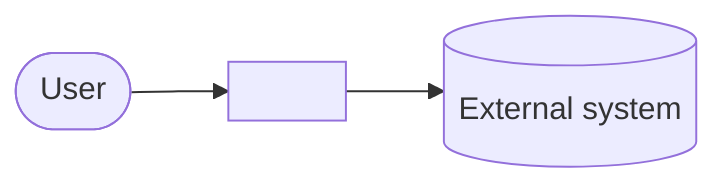
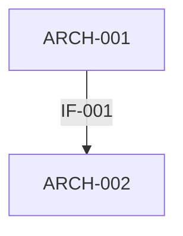
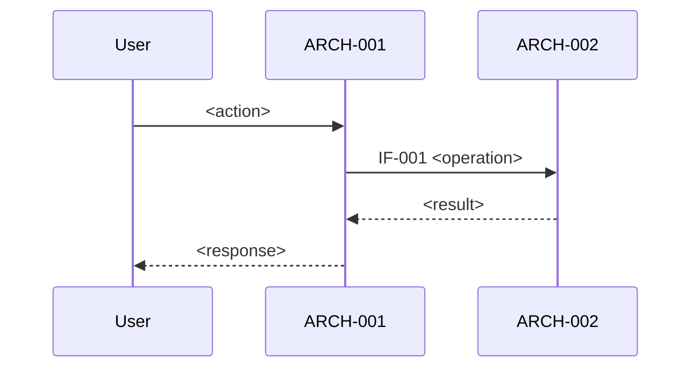

# Architecture: <product name>

- **Owner:** Architecture Agent
- **Baseline:** <tag>
- **Requirements baseline:** <tag>

## 1. Context and system boundary

### EXT-001: <external actor or system>
- **Kind:** human user | third-party API | OS service | filesystem | ...
- **Description:** <what it is and what we rely on>

## 2. Architectural style and key decisions
<Brief summary; details in `factory/decisions/DEC-###.md`.>
- DEC-001: <language/runtime> — <one-line rationale>

## 3. Components

### ARCH-001: <component name>
- **Satisfies:** REQ-001, REQ-003
- **Responsibility:** <one sentence>
- **Owns data:** <entities/state it is the source of truth for>
- **Technology:** <framework/libraries>
- **Source location:** `src/<path>/`
- **Notes:** <constraints, scaling, security considerations>

## 4. Interfaces

### IF-001: <interface name>
- **Between:** ARCH-001, ARCH-002
- **Satisfies:** REQ-003
- **Style:** in-process call | HTTP/REST | CLI | event | file | ...
- **Provider:** ARCH-002 — **Consumer:** ARCH-001
- **Operations:**
  | Operation | Input (schema) | Output (schema) | Errors |
  |---|---|---|---|
  | `<name>` | `<type/schema>` | `<type/schema>` | `<ErrorCode>: <condition>` |
- **Failure semantics:** timeout <n ms>; retries <policy>; idempotency <yes/no>; behavior when provider unavailable <...>
- **Versioning / compatibility:** <...>

## 5. Requirements allocation
| REQ | Satisfied by | Notes |
|---|---|---|
| REQ-001 | ARCH-001 | |

## 6. Non-functional mechanisms
| REQ | Mechanism | Components |
|---|---|---|
| REQ-0xx (performance) | <e.g., in-memory index> | ARCH-002 |

## 7. Runtime sequences

### Sequence for UC-001 main success scenario (exercised by SCN-001)

## 8. Integration order
<Suggested bottom-up integration order for the Integration Test Agent.>
