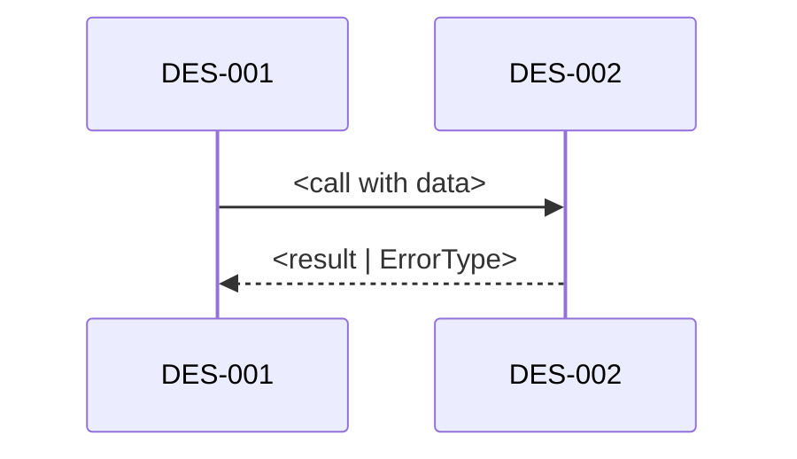

# Design: ARCH-### <component name>

- **Owner:** Design Agent
- **Baseline:** <tag>
- **Architecture baseline:** <tag>
- **Allocated requirements:** REQ-###, REQ-###
- **Realized interfaces:** IF-### (provider), IF-### (consumer)

## 1. Overview
<How the component is decomposed into units. Optional class/module diagram.>

## 2. Design units

### DES-001: <unit name>
- **Refines:** ARCH-###, IF-###
- **Responsibility:** <one sentence>
- **Source location:** `src/<path>`
- **Signature:**
  ```
  <exact signature in target language, with types>
  ```
- **Inputs:**
  | Name | Type | Valid range / format | Null/empty handling |
  |---|---|---|---|
- **Outputs:** <type, range, meaning>
- **Preconditions:** <...>
- **Postconditions:** <...>
- **Invariants:** <...>
- **Behavior:**
  1. <step>
  2. <step>
- **Decision table** (if ≥3 interacting conditions):
  | Condition / Rule | R1 | R2 | R3 |
  |---|---|---|---|
  | <cond A> | T | T | F |
  | **Result** | <x> | <y> | <z> |
- **Errors:**
  | Condition | Detection | Raised error / code | Side effects rolled back? |
  |---|---|---|---|
- **Side effects & state:** <I/O, persistence, concurrency>
- **Dependencies:** DES-###, IF-###
- **Test design hints:**
  - Equivalence classes: <valid: ...; invalid: ...>
  - Boundaries: <limit L → test L-1, L, L+1>
  - Error paths: <list>

## 3. Collaborations and interface realization (integration test oracles)

### Collaboration: <operation or flow, e.g., "IF-001 add()">

1. <step: who calls whom, with what data>
2. <error propagation: ErrorType from DES-002 → mapped to IF error code X by DES-001>

| IF operation | Realized by | Data mapping | Error mapping |
|---|---|---|---|
| IF-###.`<op>` | DES-### | <IF schema → signature types> | <IF error code ↔ error type> |

## 4. Data structures
<Types, schemas, enums, with constraints.>

## 5. Design decisions
- DEC-###: <pattern/algorithm choice> — <rationale>
