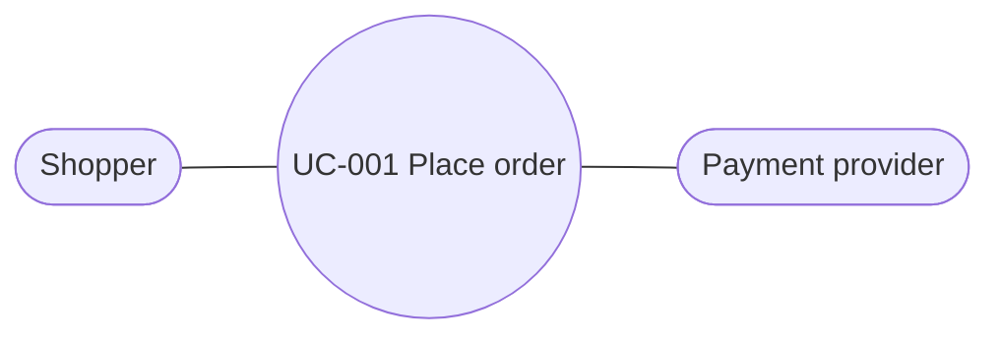

# Requirements Specification: <product name>

- **Owner:** Requirements Agent
- **Baseline:** <tag, set by orchestrator>
- **Concept:** `factory/concept/concept.md`
- **User stories:** included | omitted (from the concept's Factory options)

## 1. Glossary
| Term | Definition |
|---|---|
| <system name, e.g., "the app"> | The product being specified. Every EARS statement uses exactly this name |
| <term> | <definition> |

## 2. Actors
| Actor | Kind | Description | Goals (use cases) |
|---|---|---|---|
| <e.g., Shopper> | human | <who they are, what they know> | UC-001, UC-002 |
| <e.g., Payment provider> | external system | <what it does for us> | UC-002 (supporting) |

## 3. Assumptions
- A-1: <assumption> — Affects: REQ-### — Status: unconfirmed | confirmed (Q-###)

## 4. Constraints
<Imposed by the concept: platforms, regulations, mandated technologies.>

## 5. Use cases

### UC-001: <goal as verb + noun, e.g., "Place order">
- **Source:** CON-001
- **Primary actor:** <actor>
- **Supporting actors:** <other actors / external systems>
- **Goal:** <what the primary actor wants to achieve>
- **Level:** user goal | subfunction
- **Trigger:** <event that starts the use case>
- **Preconditions:** <what must be true before>
- **Success guarantee:** <what is true when the main flow succeeds>
- **Minimal guarantee:** <what is always true, even on failure (e.g., no partial charge)>
- **Main success scenario:**
  1. <actor> <does something>.
  2. The system <responds observably>.
  3. ...
- **Extensions (alternate and exception flows):**
  - 2a. <condition, e.g., "item out of stock">:
    1. The system <response>.
    2. <rejoin at step n | use case ends in failure>.
  - *a. <condition that can happen at any step, e.g., "session expires">: <handling>.
- **Business rules:** <rules that apply across steps, or "—">
- **Frequency / volume:** <optional: how often, how many>

> Don't list the derived requirements here. The REQs point to this use case (`Source: UC-001`), and the generated matrix shows the reverse direction.

## 6. User stories (optional — delete this section if user stories are omitted)

### US-001: <short title>
- **Source:** UC-001
- **Story:** As a <role>, I want <capability>, so that <benefit>.
- **Priority:** must | should | could
- **Acceptance criteria:**
  1. Given <context>, when <action>, then <outcome>.
- **Notes:** <optional>

> Stories are not binding on their own. Every story acceptance criterion must appear in the acceptance criteria of at least one REQ that has `Source: US-###`.

## 7. Functional requirements

> Every Statement uses EARS syntax (`docs/ears.md`) with exactly one "shall":
> `[Where <feature>,] [While <state>,] [When <trigger>, | If <condition>, then] the <system> shall <response>`.
> The `EARS` field declares the pattern: ubiquitous | event-driven | state-driven | unwanted | optional | complex.

### 7.1 <Feature area / use case>

### REQ-001: <short title>
- **Source:** UC-001, US-001
- **Type:** functional
- **Priority:** must
- **Status:** proposed
- **Use case step:** UC-001 step 2
- **EARS:** event-driven
- **Statement:** When <trigger>, the <system> shall <observable response>.
- **Rationale:** <why this exists>
- **Acceptance criteria:**
  1. Given <context>, when <action>, then <observable result with concrete values>.
  2. Given <boundary context>, when <action>, then <result>.

### REQ-002: <short title for the failure handling>
- **Source:** UC-001
- **Type:** functional
- **Priority:** must
- **Status:** proposed
- **Use case step:** UC-001 extension 2a
- **EARS:** unwanted
- **Statement:** If <undesired condition>, then the <system> shall <observable response>.
- **Rationale:** <why>
- **Acceptance criteria:**
  1. Given <context>, when <fault / invalid input>, then <observable result>.

## 8. Non-functional requirements

### REQ-0xx: <short title>
- **Source:** CON-00x
- **Type:** performance | security | privacy | reliability | availability | usability | accessibility | compatibility | maintainability | operability | compliance | constraint
- **Priority:** must
- **Status:** proposed
- **EARS:** ubiquitous | state-driven
- **Statement:** The <system> shall <measurable quality> under <conditions>.
- **Rationale:** <why>
- **Acceptance criteria:**
  1. <measurable check with threshold, environment, and method>

### Not applicable categories
| Category | Reason |
|---|---|
| <e.g., availability> | <e.g., single-user offline CLI> |

## 9. Scenarios

### SCN-001: <concrete journey title>
- **Covers:** UC-001, REQ-001, REQ-002
- **Path:** UC-001 main success scenario | UC-001 extension 2a
- **Actor:** <actor>
- **Preconditions:** <concrete starting state and data>
- **Steps:**
  1. <actor action with concrete data> → <system response>
- **Expected outcome:** <concrete end state>

## 10. Out of scope
- <explicitly excluded capability> — reason

## 11. Traceability summary
<Optional human-readable overview; the authoritative matrix is generated in `factory/trace/matrix.md`.>
